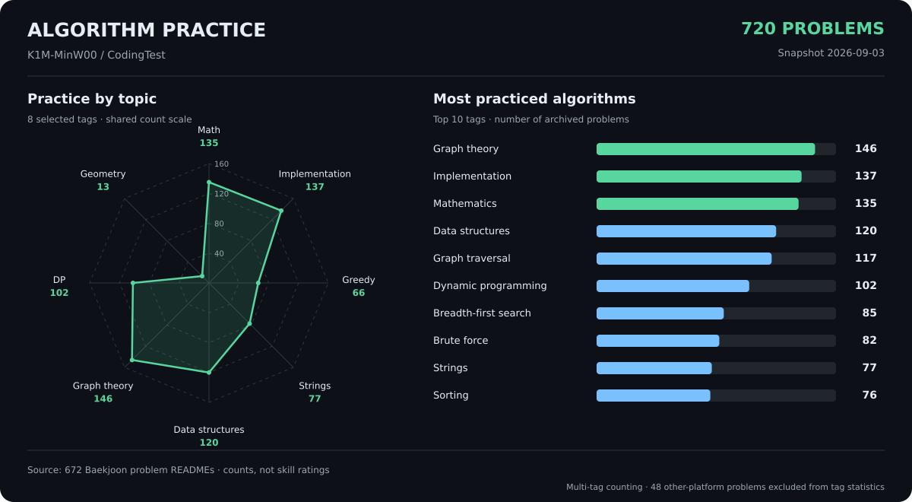

# Coding Test

**C++ 중심의 알고리즘 문제 풀이 기록**

백준, 프로그래머스, 구름LEVEL에서 해결한 문제를 모아 둔 저장소입니다. 자료 구조와 알고리즘을 학습하고, 다양한 조건의 문제를 코드로 구현하는 연습을 기록합니다.

## 풀이 현황

| 플랫폼 | 문제 수 | 저장소 내 난이도 범위 |
| --- | ---: | --- |
| [백준](백준) | 672 | Bronze ~ Platinum |
| [프로그래머스](프로그래머스) | 45 | Level 0 ~ 3 |
| [구름LEVEL](goormlevel) | 3 | 문제별 폴더 |
| **합계** | **720** | |

> **집계일: 2026-09-03** · 저장소에 업로드된 문제별 폴더 기준의 정적 통계입니다. 플랫폼 계정의 전체 풀이 수와는 다를 수 있습니다.

## 알고리즘별 풀이 통계

분류 정보가 있는 **백준 672문제**를 기준으로, **그래프 이론 146문제**, **구현 137문제**, **수학 135문제**를 가장 많이 풀었습니다. 그래프 탐색은 117문제, 다이나믹 프로그래밍은 102문제로 기록되어 있습니다.

| 순위 | 알고리즘 분류 | 문제 수 | 백준 672문제 중 비율 |
| ---: | --- | ---: | ---: |
| 1 | 그래프 이론 | 146 | 21.7% |
| 2 | 구현 | 137 | 20.4% |
| 3 | 수학 | 135 | 20.1% |
| 4 | 자료 구조 | 120 | 17.9% |
| 5 | 그래프 탐색 | 117 | 17.4% |
| 6 | 다이나믹 프로그래밍 | 102 | 15.2% |
| 7 | 너비 우선 탐색 | 85 | 12.6% |
| 8 | 브루트포스 알고리즘 | 82 | 12.2% |
| 9 | 문자열 | 77 | 11.5% |
| 10 | 정렬 | 76 | 11.3% |

### 집계 기준

- 각 문제 README의 `분류` 항목을 집계했습니다. 분류명은 저장된 표기를 유지합니다.
- 하나의 문제에 여러 태그가 있으면 각 태그에 1문제씩 반영합니다. 예를 들어 `그래프 이론, 최단 경로, 데이크스트라`는 세 분류에 각각 집계됩니다.
- 태그별 개수와 비율은 중복을 포함하므로, 합계가 전체 문제 수 또는 100%를 넘을 수 있습니다.
- 프로그래머스 45문제와 구름LEVEL 3문제는 README에 알고리즘 분류가 없어 태그 통계에서 제외했습니다. 플랫폼별 문제 수에는 포함합니다.
- 레이더 차트는 주요 8개 태그를 동일한 **문제 수 척도**로 표시합니다. 실력 점수나 레이팅을 의미하지 않습니다.

전체 알고리즘 분류 보기

| 알고리즘 분류 | 문제 수 |
| --- | ---: |
| 그래프 이론 | 146 |
| 구현 | 137 |
| 수학 | 135 |
| 자료 구조 | 120 |
| 그래프 탐색 | 117 |
| 다이나믹 프로그래밍 | 102 |
| 너비 우선 탐색 | 85 |
| 브루트포스 알고리즘 | 82 |
| 문자열 | 77 |
| 정렬 | 76 |
| 그리디 알고리즘 | 66 |
| 깊이 우선 탐색 | 47 |
| 백트래킹 | 46 |
| 해시를 사용한 집합과 맵 | 36 |
| 최단 경로 | 35 |
| 시뮬레이션 | 34 |
| 정수론 | 32 |
| 이분 탐색 | 29 |
| 스택 | 28 |
| 데이크스트라 | 27 |
| 우선순위 큐 | 25 |
| 조합론 | 21 |
| 누적 합 | 19 |
| 두 포인터 | 18 |
| 재귀 | 17 |
| 비트마스킹 | 16 |
| 소수 판정 | 16 |
| 트리 | 15 |
| 사칙연산 | 14 |
| 큐 | 14 |
| 트리를 사용한 집합과 맵 | 14 |
| 기하학 | 13 |
| 에라토스테네스의 체 | 12 |
| 덱 | 11 |
| 매개 변수 탐색 | 11 |
| 집합과 맵 | 11 |
| 격자 그래프 | 10 |
| 플로이드–워셜 | 9 |
| 분리 집합 | 8 |
| 방향 비순환 그래프 | 7 |
| 분할 정복 | 7 |
| 위상 정렬 | 7 |
| 임의 정밀도 / 큰 수 연산 | 7 |
| 많은 조건 분기 | 6 |
| 유클리드 호제법 | 6 |
| 파싱 | 6 |
| 0-1 너비 우선 탐색 | 5 |
| 슬라이딩 윈도우 | 5 |
| 역추적 | 5 |
| 분할 정복을 이용한 거듭제곱 | 4 |
| 세그먼트 트리 | 4 |
| 가장 긴 증가하는 부분 수열 문제 | 3 |
| 게임 이론 | 3 |
| 배낭 문제 | 3 |
| 벨만–포드 | 2 |
| 스위핑 | 2 |
| 연결 리스트 | 2 |
| 외판원 순회 문제 | 2 |
| 정규 표현식 | 2 |
| 최소 공통 조상 | 2 |
| 최장 공통 부분 수열 문제 | 2 |
| 플러드 필 | 2 |
| 다각형의 넓이 | 1 |
| 덱을 이용한 구간 최댓값 트릭 | 1 |
| 보이어–무어 다수결 투표 | 1 |
| 비트 집합 | 1 |
| 비트필드를 이용한 다이나믹 프로그래밍 | 1 |
| 선분 교차 판정 | 1 |
| 선형대수학 | 1 |
| 소인수분해 | 1 |
| 순열 사이클 분할 | 1 |
| 애드 혹 | 1 |
| 오일러 피 함수 | 1 |
| 이분 그래프 | 1 |
| 중간에서 만나기 | 1 |
| 중국인의 나머지 정리 | 1 |
| 최소 스패닝 트리 | 1 |
| 트라이 | 1 |
| 트리의 지름 | 1 |
| 피사노 주기 | 1 |
| 피타고라스 정리 | 1 |
| 해 구성하기 | 1 |
| 해싱 | 1 |
| 확률론 | 1 |
| 희소 배열 | 1 |

## 난이도별 분포

### 백준

| 난이도 | 문제 수 | 비율 |
| --- | ---: | ---: |
| Bronze | 60 | 8.9% |
| Silver | 387 | 57.6% |
| Gold | 216 | 32.1% |
| Platinum | 9 | 1.3% |
| **합계** | **672** | **100%** |

### 프로그래머스

| 난이도 | 문제 수 |
| --- | ---: |
| Level 0 | 9 |
| Level 1 | 7 |
| Level 2 | 16 |
| Level 3 | 13 |
| **합계** | **45** |

난이도는 저장소의 폴더 분류를 기준으로 하며, 플랫폼의 현재 난이도와 차이가 있을 수 있습니다.

## 대표 풀이

| 문제 | 구현 내용 |
| --- | --- |
| [최단경로 - 1753](%EB%B0%B1%EC%A4%80/Gold/1753.%E2%80%85%EC%B5%9C%EB%8B%A8%EA%B2%BD%EB%A1%9C) | 인접 리스트와 최소 힙을 이용한 다익스트라 |
| [평범한 배낭 - 12865](%EB%B0%B1%EC%A4%80/Gold/12865.%E2%80%85%ED%8F%89%EB%B2%94%ED%95%9C%E2%80%85%EB%B0%B0%EB%82%AD) | 물건 선택 여부와 무게 제한을 상태로 정의한 DP |
| [LCS 2 - 9252](%EB%B0%B1%EC%A4%80/Gold/9252.%E2%80%85LCS%E2%80%852) | DP 테이블을 이용한 최장 공통 부분 수열 복원 |
| [K번째 최단경로 찾기 - 1854](%EB%B0%B1%EC%A4%80/Platinum/1854.%E2%80%85K%EB%B2%88%EC%A7%B8%E2%80%85%EC%B5%9C%EB%8B%A8%EA%B2%BD%EB%A1%9C%E2%80%85%EC%B0%BE%EA%B8%B0) | 정점별 최대 힙으로 K개의 경로 비용 관리 |

## 저장소 구성

| 경로 | 구성 |
| --- | --- |
| `백준/` | 난이도 → 문제 번호·이름 → 풀이 코드와 문제 README |
| `프로그래머스/` | 레벨 → 문제 번호·이름 → 풀이 코드와 문제 README |
| `goormlevel/` | 문제 ID → 문제 폴더 → 풀이 코드와 문제 README |
| `docs/` | README에 표시하는 통계 이미지 |

주로 C++로 풀이하며, 일부 Python 풀이도 포함되어 있습니다. 문제 README에는 문제 링크, 설명, 제출 정보 등이 기록되어 있습니다.

문제 풀이 업로드에는 [BaekjoonHub](https://github.com/BaekjoonHub/BaekjoonHub)를 활용합니다. 위 통계와 그래프는 집계일의 스냅샷이며 자동 갱신되지 않습니다.
